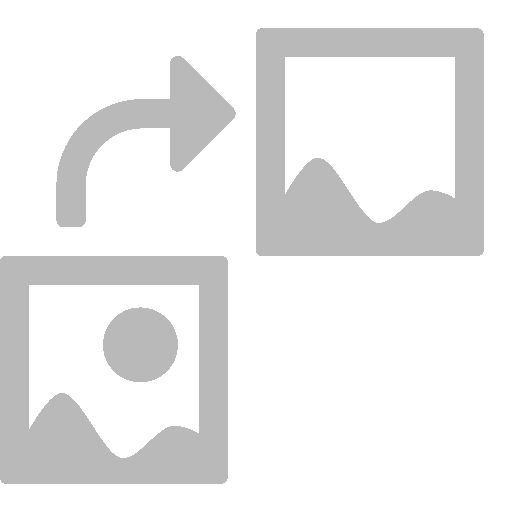

# Preenchimento sensível ao conteúdo

<table>
  <tr>
    <td>Ferramentas de  <strong>Entrada:</strong></td>
    <td>Descrição O preenchimento sensível ao conteúdo permite remover facilmente elementos como dirt, texto ou outros objetos indesejados de seus materiais. No exemplo de chão de floresta abaixo, o bastão se destaca no padrão de repetição. Com o Preenchimento sensível ao conteúdo, podemos remover o galho, tornando a repetição um pouco menos perceptível.    <em>Antes da remoção</em>   <em>Após a remoção</em></td>
  </tr>
</table>

## Parâmetros

* **Seleção de Canais:** selecione em quais canais o filtro deve ser executado. Por padrão, essa opção é definida como todos os canais; no entanto, também é possível optar por executar somente nos canais de Height ou de Cor de base.
* **Espelho:** para materiais ou padrões simétricos, esta configuração orienta o Preenchimento sensível ao conteúdo para incorporar conteúdo de espelhamento no material.
* **Escala:** para padrões geométricos, como ladrilhos ou tijolos, esta configuração pode ajudar a manter a estrutura do padrão.

### Parâmetros técnicos

* **Máscara personalizada:** aplique uma máscara usando uma textura ou use o pincel para tinta sua própria máscara no **Visor 2D**.
* **Fator de Corte da Pesquisa:** corte a área de amostra usada pelo filtro. Por padrão, a área de amostra cobre toda a textura, exceto a área mascarada. O aumento do **Fator de corte da pesquisa** diminui a área de amostra, o que pode ajudar a limitar as amostras em pixels mais próximos da área mascarada.

### Configurações de preenchimento

* **Adaptação de cor:** ajuste o quanto o preenchimento tenta se adaptar às cores ao redor. Essa configuração pode ser útil com materiais que
* **Adaptação de rotação:** para padrões onde a rotação de elementos é importante, como as pétalas de uma flor ou os raios de uma roda, essa configuração pode ajudar a criar resultados mais consistentes.