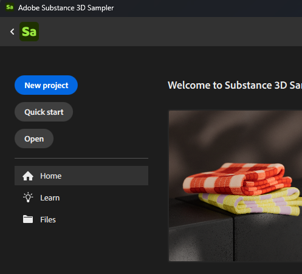

# Gerenciamento de projetos

No Substance 3D Sampler, você pode usar coleções para gerenciar todos os seus ativos e materiais. Os projetos são uma boa maneira de organizar seus materiais. Um projeto pode ser exportado ou importado para ser facilmente compartilhado entre computadores.

## Criar um novo projeto

Para criar um novo projeto, selecione **Criar novo** na tela **Início** ou **Arquivo > Novo Projeto**. Criar um novo projeto iniciará a caixa de diálogo Início Rápido, onde você pode selecionar uma [Ação Rápida](../features-and-workflows/quick-actions.md) ou importar uma imagem ou um arquivo Substance para iniciar seu projeto.

>[!TIP]
>
> Se você é novo no Sampler, as [Ações rápidas](../features-and-workflows/quick-actions.md) podem ajudar você a começar rapidamente, aprendendo mais sobre o que o Sampler pode ajudar você a alcançar.

Como alternativa, você pode usar o botão **Início rápido** para ir diretamente para um projeto vazio. Você ainda pode importar manualmente ativos e conteúdo conforme necessário.

Depois de clicar no botão “Criar Novo”, o projeto será automaticamente aberto e nomeado como “*Projeto Sem Título\**” até que você salve seu projeto. Você pode adicionar ativos ao seu projeto com o **botão Novo ativo** realçado no **painel Projeto**.

{width="600px"}

## Salvar um projeto

Para salvar um projeto, use a ação de menu **Arquivo > Salvar** ou **Salvar como**. Isso abrirá uma caixa de diálogo que permite escolher o nome a ser usado e onde salvar os arquivos de projeto.

Como alternativa, você pode usar o atalho **Ctrl + S** para **Salvar** ou **Ctrl + Shift + S** para **Salvar como**.

Os projetos salvos aparecem como um arquivo chamado **YourProject.ssa**. SSA é o formato de arquivo samplers, que armazena informações sobre seu projeto e quaisquer dependências que ele possa ter.

## Abrir um projeto existente

Os projetos podem ser abertos de algumas maneiras:

* Na **Tela inicial**: use a lista de projetos recentes para abrir rapidamente um projeto clicando duas vezes nele.
* Na **Tela Inicial**: clique em **Abrir** para abrir um navegador de arquivos onde você possa escolher o arquivo que deseja abrir.
* Por meio do menu **Arquivo > Abrir projeto**.
